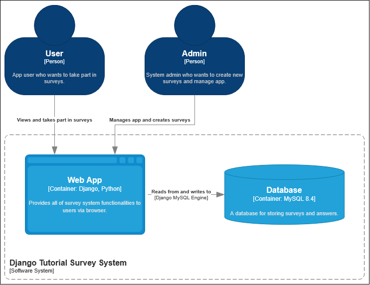
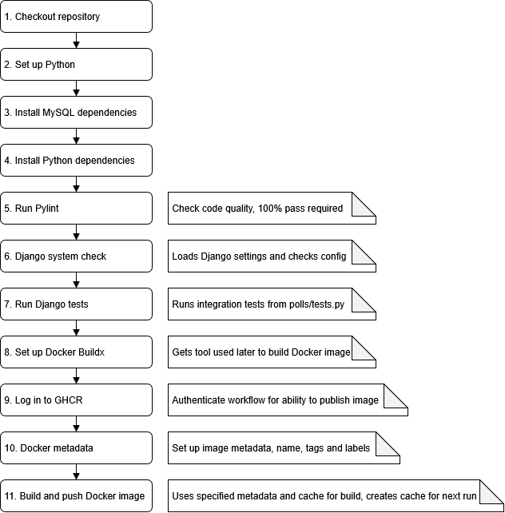

# Web Application Deployment - WUDA Project

## Overview

The aim of this project was to prepare a basic Django web application for an automated deployment process to a production environment.

The project includes adapting the application to run in Docker containers, configuring a CI/CD pipeline using GitHub Actions, building and publishing container images, and later deploying the application to a Kubernetes cluster using Helm Charts.

Additionally, monitoring of the production application and alerting mechanisms will be implemented.

**Figure 1. C4 Container Diagram of the System**

## Stage 1 - Dockerization and CI/CD

The first stage focused on preparing the Django application for production and automating the process of building and publishing Docker images.

The following tasks were completed:

- Replaced the local SQLite database used by the application with a production MySQL database.
- Disabled development tools and configurations in the application.
- Configured Gunicorn as the production application server.
- Created a `Dockerfile` for building the web application image.
- Created a `docker-compose.yml` file to manage the execution of the database and web application containers.
- Created a CI/CD workflow using GitHub Actions, triggered by repository updates. The workflow:
  - Checks the application code.
  - Runs automated tests.
  - Builds the web application Docker image.
  - Publishes the image to GitHub Container Registry (GHCR).

**Figure 2. CI/CD Pipeline Diagram**

TEST CI/CD